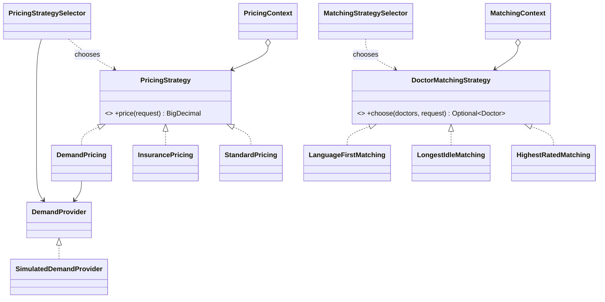

# Telemedicine Platform: Strategy Pattern (Assignment 5)

Java 17, JUnit 5. Domain: **Telemedicine** (same domain as Assignment 4).

The platform has two places where an algorithm must be exchangeable at runtime, so there are two Strategy families:

| Family | Question it answers | Strategies |
|---|---|---|
| **Pricing** | How much does the consultation cost? | `StandardPricing`, `InsurancePricing`, `DemandPricing` |
| **Doctor matching** | Which doctor takes the request? | `HighestRatedMatching`, `LongestIdleMatching`, `LanguageFirstMatching` |

Each family has an interface, a **Context** (holds a strategy, `setStrategy()`, no `if`/`switch` on the type) and a separate **Selector** (the only place with selection rules).

## How to run

```bash
./run.sh      # compiles with plain javac and runs the console demo
./test.sh     # runs all JUnit 5 tests (Maven if installed, otherwise the JUnit console launcher)
mvn test      # the same through Maven
```

## Structure



### Selector rules

| Selector | Rule 1 | Rule 2 | Otherwise |
|---|---|---|---|
| `PricingStrategySelector` | patient has insurance: `InsurancePricing` | urgent request or load >= 1.0: `DemandPricing` | `StandardPricing` |
| `MatchingStrategySelector` | urgent request: `LongestIdleMatching` | patient language is not "ru": `LanguageFirstMatching` | `HighestRatedMatching` |

## Class responsibilities

| Class | Responsibility |
|---|---|
| `Specialty` | Names a medical field. |
| `Insurance` | Describes covered minutes of a policy with its fixed copay. |
| `Patient` | Describes a person who asks for a consultation. |
| `Doctor` | Describes a doctor with specialty, rating, languages, idle time, availability. |
| `ConsultationRequest` | Describes what a patient asks for: specialty, duration, urgency. |
| `DemandProvider` | Our own interface that tells how busy the platform is right now. |
| `SimulatedDemandProvider` | Simulates the platform load from the hour of the day. |
| `RateCard` | Gives the base price per minute for a specialty. |
| `Money` | Rounds amounts to two decimals. |
| `PricingStrategy` | Defines one way to calculate the price of a consultation. |
| `StandardPricing` | Multiplies the rate of the specialty by the duration. |
| `InsurancePricing` | Charges the copay plus full rate for minutes the policy does not cover. |
| `DemandPricing` | Multiplies the standard price by a factor that grows with the load. |
| `PricingContext` | Holds one pricing strategy, lets the client replace it, delegates the calculation. |
| `PricingStrategySelector` | Picks a pricing strategy for a request from insurance, urgency, load. |
| `PricingType` | Names the pricing variants known by the legacy entry point. |
| `PriceCalculator` | Keeps the original public API; delegates each type to its strategy. |
| `DoctorMatchingStrategy` | Defines one way to pick a doctor for a request. |
| `CandidateFilter` | Keeps only available doctors with the requested specialty. |
| `HighestRatedMatching` | Picks the candidate with the best rating. |
| `LongestIdleMatching` | Picks the candidate who has waited for a patient the longest. |
| `LanguageFirstMatching` | Prefers candidates who speak the patient language, then takes the best rated. |
| `MatchingContext` | Holds one matching strategy, lets the client replace it, delegates the choice. |
| `MatchingStrategySelector` | Picks a matching strategy for a request from urgency, language. |
| `Main` | Demonstrates both families with manual choice, Selector, runtime switching. |

## Why Strategy, not State or Template Method

**Strategy.** The client (or the Selector) decides which algorithm to use. The algorithms are independent, interchangeable and do not know about each other. The context stays the same object while the strategy inside is replaced, for example when the platform load rises in the evening or a patient turns urgent. A strategy has no memory of previous calls and never replaces itself.

**Not State.** In State the object changes its own behaviour because its internal state changes, and the state objects usually trigger the transitions themselves (`Draft -> Submitted -> Approved`). Here nothing moves from `StandardPricing` to `DemandPricing` by itself: the outside world (the Selector, the demo code) chooses. There are no transitions and no "current state" of the consultation.

**Not Template Method.** Template Method fixes the skeleton of the algorithm in a base class and lets subclasses override single steps, so the variation is chosen at compile time by inheritance. Our strategies share no skeleton: `InsurancePricing` and `DemandPricing` compute the price in different ways. The variation is chosen at runtime by composition (the context has a strategy), which also allows a lambda as a strategy in tests.

## Isolation from change (Clean Code, chapter 10)

`DemandPricing` and `PricingStrategySelector` need the platform load, which in real life comes from outside (a queue service, monitoring). They depend only on our interface `DemandProvider`. Today `SimulatedDemandProvider` implements it; tomorrow an HTTP client can replace it without touching a single strategy. In tests `FakeDemandProvider` returns a fixed number, so the tests never depend on the clock or the network.

## Refactoring history (Git)

| Step | Commit | What it shows |
|---|---|---|
| BEFORE | [`6b969e6`](https://github.com/<your-username>/telemedicine-strategy/commit/6b969e616c38727b65f6d1355d0f11a4eaf46e01) (tag `before-refactoring`) | `PriceCalculator` with one `switch` over `PricingType` and an `if`-chain for the demand multiplier |
| AFTER | [`c2c36de`](https://github.com/<your-username>/telemedicine-strategy/commit/c2c36de03ce0e8e39257c6cfbeccb08c7e121561) (tag `after-refactoring`) | three strategy classes plus `PricingContext`; the `switch` is gone |

`PricingRegressionTest` is byte-for-byte identical on both commits and passes on both:

```bash
git checkout before-refactoring && USE_CONSOLE=1 ./test.sh
git checkout after-refactoring  && USE_CONSOLE=1 ./test.sh
git checkout main
```

`PriceCalculator` stays after the refactoring only as the unchanged public entry point that the regression test uses; internally it is a lookup table of strategies.

## Tests

* One test class per strategy (6) and per Context (2), one test per Selector rule (2 selector classes).
* `PricingStrategiesParameterizedTest` and `MatchingStrategiesParameterizedTest` run the same checks on every strategy of a family (`@ParameterizedTest` + `@MethodSource`).
* `PricingRegressionTest` guards the refactoring.
* `FakeDemandProvider` replaces the external data source.
